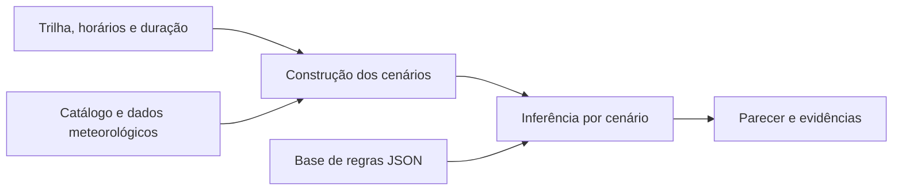

# Trilhas RJ

**Sistema especialista para planejar trilhas no estado do Rio de Janeiro.**

O Trilhas RJ cruza o catálogo de percursos com previsão meteorológica, chuva medida em estações e informações sobre trechos documentados. A partir da trilha, da data e do horário de saída, o sistema estima a janela da caminhada, aplica regras e explica quais condições motivaram cada recomendação. O projeto foi desenvolvido como trabalho final da disciplina de Tópicos Especiais em Inteligência Artificial da UFRRJ.

## Problema e abordagem

A pergunta do projeto é como comparar horários de saída para um mesmo percurso a partir da previsão, da chuva antecedente e das características documentadas do terreno. O Trilhas RJ implementa um **sistema especialista baseado em regras de produção**. O conhecimento do domínio fica em uma base declarativa em JSON. O motor de inferência, escrito em Python, avalia essa base sobre os fatos de cada cenário e registra quais condições sustentaram o resultado.

## Arquitetura e fluxo de inferência



1. **Entrada.** A interface web ou a CLI recebe a trilha, a data e os horários de saída. O sistema usa a duração do catálogo quando ela está disponível ou recebe a duração planejada.
2. **Aquisição.** O módulo [comparar_saidas.py](trabFinal/src/comparar_saidas.py) consulta a previsão horária na coordenada de referência. O módulo [observacoes.py](trabFinal/src/observacoes.py) recupera a chuva observada a partir dos vínculos entre trilhas e estações.
3. **Construção de fatos.** Para cada horário, o sistema estima o retorno e calcula indicadores para a caminhada e para as 24 horas que antecedem a saída. A análise por trecho usa os limites cadastrados no GPX para estimar a janela de passagem e recortar a previsão correspondente.
4. **Inferência e explicação.** O módulo [inferencia.py](trabFinal/src/inferencia.py) avalia as regras habilitadas. A resposta registra ID, versão, escopo, valores avaliados, entradas indisponíveis e o estado da regra. A interface usa essas evidências para explicar os conselhos e as lacunas.

## Bases de dados

| Base | Formato e origem | Uso na análise |
|---|---|---|
| Catálogo de trilhas | [trilhas.csv](trabFinal/trilhas.csv), [fontes.csv](trabFinal/fontes.csv), [ponto_interesse.csv](trabFinal/ponto_interesse.csv) e [trilha_texto.csv](trabFinal/trilha_texto.csv), com referências a registros do Wikiloc | Identifica percursos por `id_trilha` e reúne localização de referência, distância, duração e metadados quando disponíveis. |
| Traçados e trechos | Arquivos [GPX](trabFinal/gpx/) e [trechos.json](trabFinal/conhecimento/trechos.json) | O GPX fornece a geometria e a distância acumulada. O cadastro associa limites e atributos a segmentos documentados. |
| Previsão meteorológica | API horária do [Open-Meteo](https://open-meteo.com/) | Fornece precipitação, temperatura, sensação térmica, rajadas, visibilidade, índice UV e códigos meteorológicos. A consulta também recebe os horários de nascer e pôr do sol. |
| Precipitação observada | [Vínculos aprovados](trabFinal/vinculos-aprovados.csv), [base piloto](trabFinal/observacao-piloto.csv) e fontes das redes [Cemaden](https://www.gov.br/cemaden/) e [Alerta Rio](https://www.sistema-alerta-rio.com.br/) | Associa a trilha a uma estação e recupera, quando possível, o acumulado observado em uma janela de 24 horas. |

O sistema mantém a **previsão das 24 horas anteriores à saída** e a **chuva observada pela estação** como fatos distintos. O acumulado previsto exige cobertura integral da janela e é ponderado pela fração de cada hora que coincide com ela. Para a chuva observada entrar nas regras, a leitura precisa ter cobertura de 100%, estar dentro da tolerância de 30 minutos em relação à consulta e ter uma janela encerrada até a saída. Quando o Cemaden publica um acumulado sem confirmar a cobertura, o valor é preservado como informação da fonte e fica fora da inferência. Os vínculos, campos e convenções estão no [dicionário de dados](trabFinal/documentacao/dicionario-de-dados-trilhas-rj.md).

## Base de conhecimento

A versão **0.5.0** de [regras.json](trabFinal/conhecimento/regras.json) contém **55 regras**, com **44 habilitadas no piloto experimental** e **11 em proposta**. Cada regra declara seu escopo, entradas, condições, nível e referências. Os escopos incluem caminhada, trecho e diagnóstico de cobertura.

O motor combina as condições da regra com **E lógico**. Quando todas são verdadeiras, a regra é **acionada**. Uma condição falsa resulta em **critério não atingido**, mesmo que falte outro dado. Quando nenhuma condição conhecida é falsa e falta um dado necessário, o resultado é **não avaliável**. Regras com restrições específicas de aplicação também podem ficar **fora do escopo**. O nível do cenário corresponde à maior severidade entre as regras acionadas que definem um nível de atenção.

| Regra | Condição de ativação | Nível |
|---|---|---|
| `CH01` · Pico horário de chuva | Pelo menos 5 mm em uma hora que coincide com a caminhada, com cobertura integral da janela. | Atenção |
| `CH05` · Chuva antecedente observada | Leitura válida de pelo menos 20 mm em 24 h, com a janela de observação encerrada até 6 h antes da saída. | Atenção |
| `VE01` · Rajadas em trecho exposto | Rajada de pelo menos 50 km/h na passagem por trecho cadastrado como crista, cume ou laje exposta. | Atenção alta |
| `MT01` · Tempestade prevista | Pelo menos um código meteorológico WMO 95, 96, 97 ou 99 na janela da caminhada. | Crítico |

Os limiares são critérios experimentais do projeto. O [dicionário de regras](trabFinal/documentacao/dicionario-regras-trilhas-rj.md) lista as condições, os escopos e os estados de implementação de todas as regras.

## Executar localmente

Use Python 3.12 e execute os comandos a partir da raiz do repositório. As consultas em tempo real exigem internet.

### Linux ou macOS

```bash
cd trabFinal
python3 -m venv .venv
. .venv/bin/activate
python -m pip install requests tzdata
python src/planejar_trilha.py
```

### Windows (PowerShell)

```powershell
cd trabFinal
py -3.12 -m venv .venv
.\.venv\Scripts\python.exe -m pip install requests tzdata
.\.venv\Scripts\python.exe src/planejar_trilha.py
```

Abra [http://127.0.0.1:8000](http://127.0.0.1:8000). Selecione uma trilha, uma data e um horário futuro. Informe a duração se o catálogo não tiver esse valor. Preencha o segundo horário caso queira comparar duas saídas. Para encerrar o servidor, pressione `Ctrl+C` no terminal.

### Reproduzir uma consulta sem internet

Na pasta `trabFinal`, com o ambiente Python preparado, rode este exemplo para recalcular a análise da **Trilha dos 7 Degraus**, em Paraty, com insumos gravados:

```bash
python src/comparar_saidas.py --reproduzir experimentos/7-degraus-chuva.json --inferencia-experimental
```

No Windows, você pode substituir `python` por `.\.venv\Scripts\python.exe`. Para uma consulta ao vivo pela linha de comando, o mesmo script aceita `--trilha`, `--data`, `--saidas` e `--duracao`. Use `--help` para ver os formatos e a opção de gravar os insumos.

### Gerar um pacote executável para Windows

Em um Windows com Python 3.12 de 64 bits, abra o PowerShell na pasta `trabFinal` e execute:

```powershell
powershell -NoProfile -ExecutionPolicy Bypass -File .\gerar-exe.ps1
```

O [script de empacotamento](trabFinal/gerar-exe.ps1) gera `dist/TrilhasRJ-Windows.zip`. Para abrir o aplicativo distribuído, extraia o ZIP e clique duas vezes em `TrilhasRJ.exe`. A interface abre no navegador e as consultas ao vivo exigem internet.

## Estrutura do projeto

| Caminho em `trabFinal/` | Conteúdo |
|---|---|
| `src/planejar_trilha.py` | Interface web e servidor local |
| `src/comparar_saidas.py` | Consulta, construção dos cenários e CLI |
| `src/inferencia.py` | Avaliação das regras e registro dos resultados |
| `conhecimento/` | Base de regras e trechos cadastrados |
| `trilhas.csv`, `fontes.csv`, `ponto_interesse.csv`, `trilha_texto.csv` | Catálogo, referências e metadados dos percursos |
| `gpx/` | Traçados disponíveis |
| `documentacao/` | Dicionários, modelagem e documentação técnica |
| `experimentos/` | Consultas gravadas, cenários simulados e painéis de experimentação |

## Limitações

A previsão representa a coordenada de referência da trilha. A avaliação por trecho depende da qualidade do traçado e da localização dos atributos do terreno. A chuva observada descreve as condições na estação vinculada, que pode estar a quilômetros do percurso. Uma avaliação pode retornar recomendações e, ao mesmo tempo, registrar lacunas para outras regras.

O sistema é experimental e auxilia no planejamento. Para decidir sobre a saída, consulte também os [avisos oficiais do INMET](https://avisos.inmet.gov.br/) e as condições de acesso informadas pelo órgão gestor.
